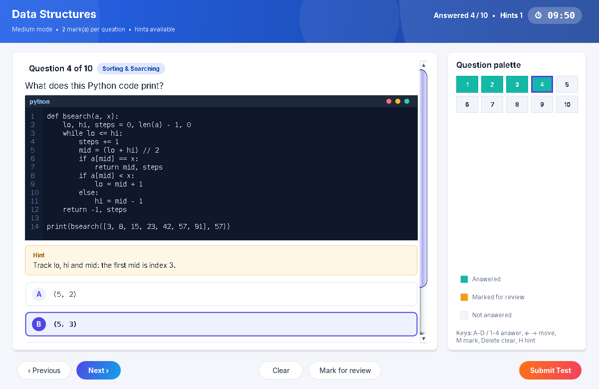
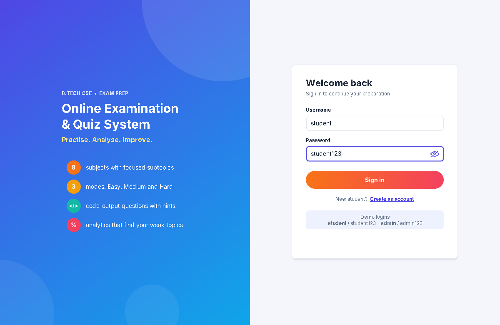
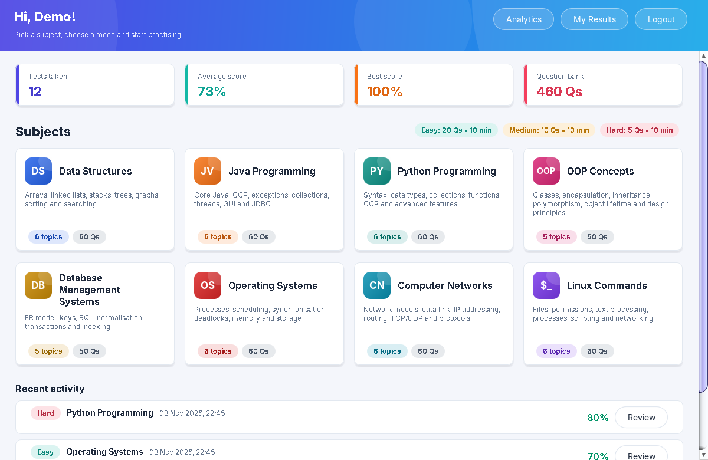
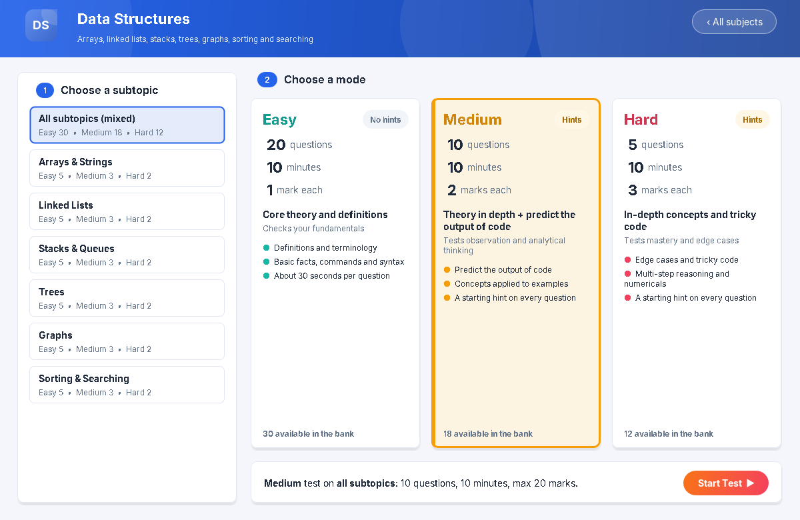
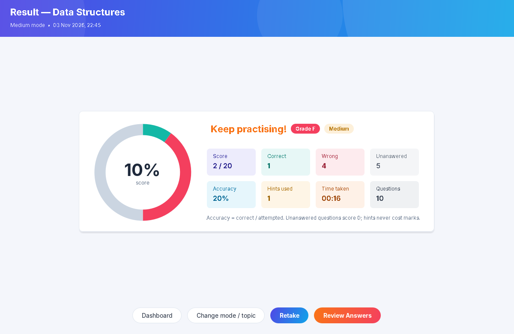
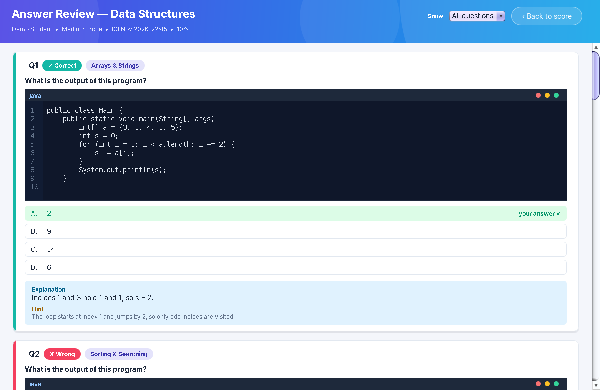
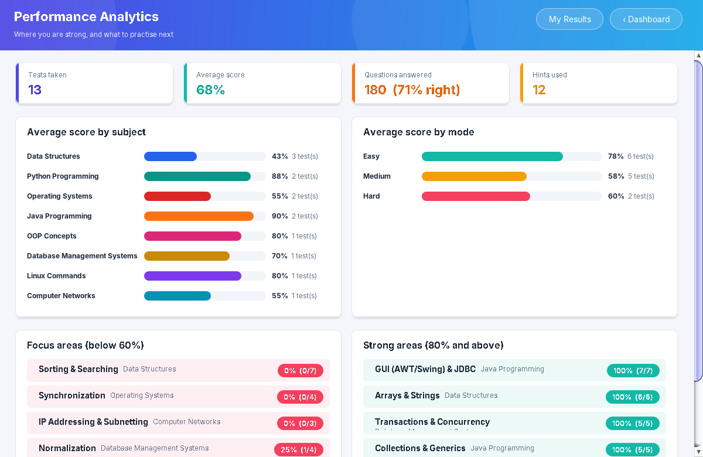
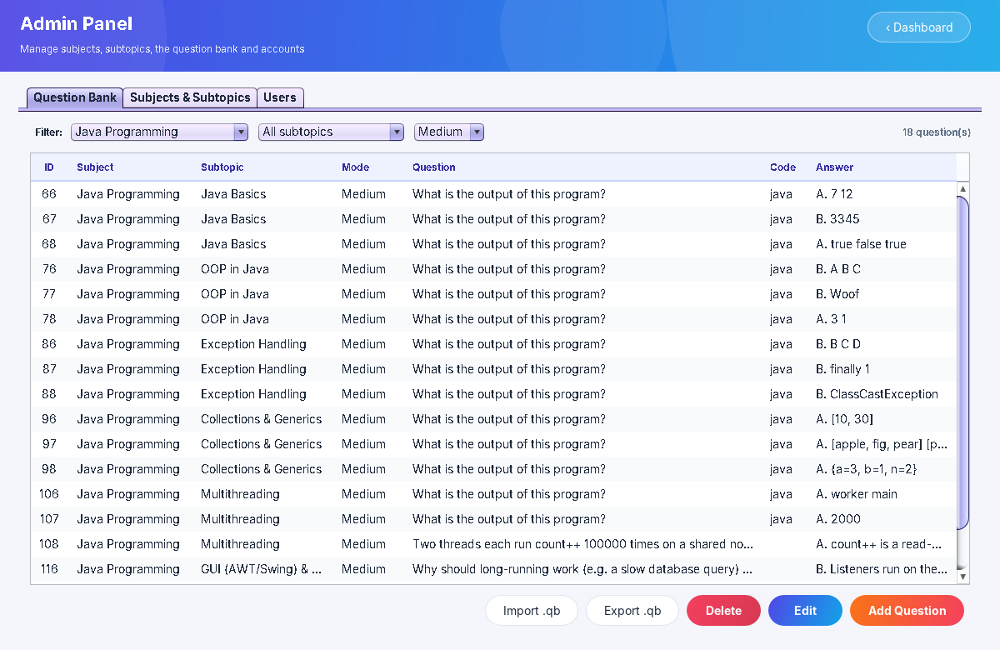
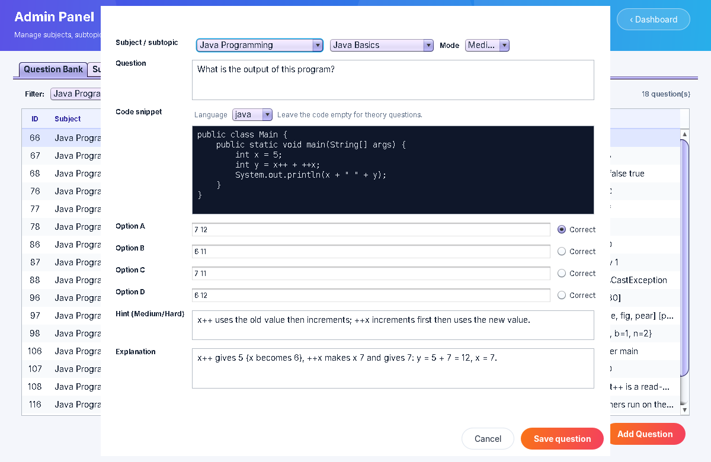
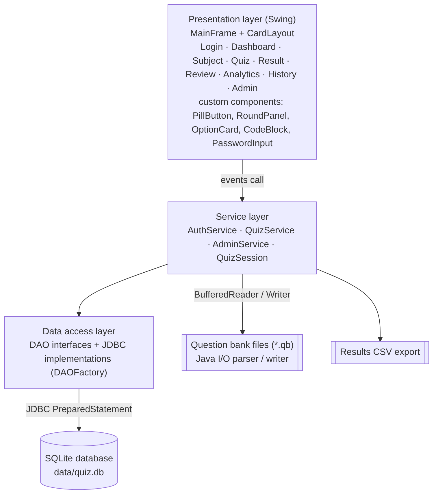

# Online Examination & Quiz System

A desktop exam-practice app for B.Tech CSE students, written in **Java Swing + JDBC (SQLite) + Java I/O**.
Students take timed MCQ tests on 8 core subjects in three difficulty modes. Medium and Hard tests include
"predict the output" code questions with hints, and an analytics screen shows which subtopics need more practice.



▶ **Demo video (23 s):** [`docs/launch-video/brag.mp4`](docs/launch-video/brag.mp4)

---

## Contents
- [Quick start](#quick-start)
- [Install Java (one time)](#1-install-java-one-time)
- [Run from an IDE](#run-from-an-ide)
- [Logins](#logins)
- [Features](#features)
- [Screenshots](#screenshots)
- [Architecture](#architecture)
- [Project structure](#project-structure)
- [Adding questions](#adding-questions)
- [Settings](#settings)
- [Tests](#tests)
- [Troubleshooting](#troubleshooting)
- [Docs for submission](#docs-for-submission)

---

## Quick start

```bash
git clone https://github.com/rayvolt-999/OnlineQuizSystem.git
cd OnlineQuizSystem

./run.sh        # Linux / macOS
run.bat         # Windows (double-click or run in Command Prompt)
```

The first run compiles everything (a few seconds), creates `data/quiz.db` and loads the 460 bundled
questions. Later runs start immediately. **The only thing you need installed is a JDK, version 11 or newer.**
The SQLite JDBC driver is already in `lib/`.

### 1. Install Java (one time)

Check first: `javac -version` must print **11 or higher**. A JRE alone is not enough; you need a JDK, which includes `javac`.

| OS | Command |
|---|---|
| Fedora | `sudo dnf install java-21-openjdk-devel` |
| Ubuntu / Debian | `sudo apt install openjdk-21-jdk` |
| Arch | `sudo pacman -S jdk21-openjdk` |
| macOS (Homebrew) | `brew install openjdk@21` and follow the `sudo ln -sfn …` line it prints |
| Windows | Install **Temurin 21 (JDK)** from https://adoptium.net. Tick **"Add to PATH"** and **"Set JAVA_HOME"** during setup, then open a **new** Command Prompt |

### 2. Get the code
```bash
git clone https://github.com/rayvolt-999/OnlineQuizSystem.git
cd OnlineQuizSystem
```
No git? On GitHub use **Code → Download ZIP**, then extract it.

### 3. Run it
| OS | Command |
|---|---|
| Linux / macOS | `chmod +x *.sh` (only if you get "Permission denied"), then `./run.sh` |
| Windows | `run.bat` |

Prefer to build and run by hand?
```bash
./build.sh                                  # compiles to out/ and packages dist/OnlineQuizSystem.jar
java -jar dist/OnlineQuizSystem.jar         # run from the project folder so data/ is created here
```

---

## Run from an IDE

**Cursor / VS Code:**
1. Open the project folder (the one that contains `src/`).
2. Install the **Extension Pack for Java** (Microsoft).
3. Wait for the Java status icon to finish loading. Then, in **Run and Debug**, choose **Run Quiz App** and press F5.

The `.vscode/` settings already point the IDE at `src/`, `resources/` and the jar in `lib/`.

**IntelliJ IDEA:**
1. **File → Open** the folder.
2. Mark `src` as a Sources Root, `resources` as a Resources Root and `test` as a Test Sources Root.
3. **Project Structure → Libraries → +** and add `lib/sqlite-jdbc-3.46.1.3.jar`.
4. Run `com.quiz.Main`. Set the working directory to the project folder.

**Eclipse:** Import → *Existing folder as project*. Add `src`, `resources` and `test` as source folders, add the jar from `lib/` to the Build Path, and run `com.quiz.Main`.

---

## Logins

| Role | Username | Password |
|---|---|---|
| Admin | `admin` | `admin123` |
| Student | `student` | `student123` |

New students can register from the login screen. Each computer has its own database (`data/quiz.db`, not
committed to git), so accounts and results stay on the machine where they were created.
To reset everything, delete `data/quiz.db` and start the app again.

---

## Features

| | |
|---|---|
| **Subjects** | Data Structures, Java, Python, OOP Concepts, DBMS, Operating Systems, Computer Networks, Linux Commands: 46 subtopics, 460 questions |
| **Modes** | **Easy**: 20 Qs, 10 min, 1 mark each (theory) · **Medium**: 10 Qs, 10 min, 2 marks (theory + predict the code output) · **Hard**: 5 Qs, 10 min, 3 marks (in-depth concepts and tricky code) |
| **Test scope** | A whole subject (all subtopics mixed, always a full test) or one subtopic for focused practice |
| **Code questions** | Java, Python, C/C++, SQL and bash snippets in a dark code viewer. All 124 code-output answers were verified by running the code |
| **Hints** | Every Medium/Hard question has a starting hint. Hints are free but recorded in the result |
| **Test screen** | Countdown with auto-submit, question palette, mark for review, clear answer, keyboard shortcuts (A–D, ←/→, M, H, Delete) |
| **Results** | Score, grade, accuracy, hints used, time. Unanswered questions are listed before submit and score 0 |
| **Review** | Your answer vs. the correct answer, with an explanation for every Medium/Hard question |
| **Analytics** | Average score by subject and by mode; weak (< 60 %) and strong (≥ 80 %) subtopics |
| **History** | Filter by subject or mode, export to CSV |
| **Admin panel** | Manage subjects (colour, badge), subtopics and questions (code, hint, explanation); import/export `.qb` question banks; add admins |
| **Security** | Salted SHA-256 passwords, PreparedStatement everywhere, transactions for saving results |

## Screenshots

| | |
|---|---|
|  |  |
|  |  |
|  |  |
|  |  |

## Architecture



- **Presentation (Swing):** `MainFrame` swaps screens with a `CardLayout`. Custom-painted widgets live in `ui/components`.
- **Service:** `QuizSession` holds a test's state (answers `Map`, marked `Set`, hints) and does the scoring. `QuizService`, `AdminService` and `AuthService` apply the rules.
- **Data access:** DAO interfaces with JDBC implementations created by `DAOFactory`. One SQLite file; the schema is versioned and migrated automatically.
- **File I/O:** question banks in `.qb` text files (`QuestionBankFormat`) and results export to CSV.

More diagrams: [class diagram](docs/diagrams/class_diagram.png) · [ER diagram](docs/diagrams/er_diagram.png)

## Project structure

```
src/com/quiz/
  Main.java              entry point (theme, database set-up, window)
  model/                 Subject, Subtopic, Question, Difficulty, QuizResult, AnswerRecord, TopicStat, User
  exception/             QuizException → DataAccess / Validation / Authentication
  db/                    DatabaseManager (JDBC connection, schema, migration), DataSeeder (first-run data)
  dao/                   DAO interfaces + DAOFactory
  dao/jdbc/              JDBC/SQLite implementations
  service/               QuizSession, QuizService, AdminService, AuthService
  util/                  QuestionBankFormat (.qb), CsvUtil, PasswordUtil, AppConfig
  ui/                    screens: Login, Dashboard, Subject, Quiz, Result, Review, Analytics, History, Admin
  ui/components/         PillButton, RoundPanel, OptionCard, CodeBlock, PasswordInput (eye toggle), charts…
resources/seed/          bundled question banks, one .qb file per subject (+ index.txt)
test/com/quiz/           SelfTest.java: 95 automated checks, no external libraries
lib/                     sqlite-jdbc driver (the only dependency)
docs/                    report, presentation, diagrams, screenshots, demo video, sample .qb
build.* / run.* / test.* build, run and test scripts for Linux/macOS (.sh) and Windows (.bat)
config.properties        mode settings and negative marking
```

## Adding questions

Questions are plain text, so anyone on the team can add them without touching Java code:

```
@subject Data Structures | DS | #2563EB | Arrays, lists, trees ...
@subtopic Linked Lists

[MEDIUM]
Q: What is the output of this program?
CODE java
public class Main { ... }
END
A) 1 2 3
B) 3 2 1
C) 3
D) 1
ANSWER: B
HINT: Watch what happens to cur.next in each iteration.
EXPLAIN: This is the classic in-place reversal.
```

- **To the running app:** log in as admin, go to **Admin Panel → Question Bank → Import .qb** and pick your file. See [`docs/sample_import.qb`](docs/sample_import.qb).
- **To the bundled bank:** edit the files in `resources/seed/`. They are loaded only into a **new** database, so delete `data/quiz.db` afterwards.
- Invalid questions are skipped and reported with their file and line number.

## Settings

Edit `config.properties` and restart the app:

```properties
easy.questions=20    easy.minutes=10    easy.marks=1
medium.questions=10  medium.minutes=10  medium.marks=2
hard.questions=5     hard.minutes=10    hard.marks=3
marks.wrong=0        # e.g. 0.25 for negative marking
```
(Each setting goes on its own line in the real file.)

## Tests

```bash
./test.sh       # Linux / macOS
test.bat        # Windows
```
This runs 95 checks: scoring, hints, modes, database, import/export and the upgrade of old databases.
It uses temporary databases, so your `data/quiz.db` is never touched. Expected output: `Passed: 95   Failed: 0`.

## Troubleshooting

| Problem | Fix |
|---|---|
| `javac: command not found` / `'javac' is not recognized` | Install a **JDK** (see step 1). On Windows, open a new Command Prompt after installing |
| `UnsupportedClassVersionError` | Your `java` is older than 11. Run `java -version` and install JDK 11+ |
| `./run.sh: Permission denied` | `chmod +x *.sh` |
| `SQLite JDBC driver not found` | Run from the project folder, and check that `lib/sqlite-jdbc-3.46.1.3.jar` exists (the full git clone includes it) |
| Window is very small on a 4K screen (Linux) | `java -Dsun.java2d.uiScale=2 -cp "dist/OnlineQuizSystem.jar:lib/*" com.quiz.Main` |
| Want a fresh start | Delete `data/quiz.db` |
| Red errors in Cursor / VS Code | Command Palette → **Java: Clean Java Language Server Workspace** → Restart |

## Docs for submission

- [`docs/Project_Report.docx`](docs/Project_Report.docx): 20-page project report
- [`docs/Project_Presentation.pptx`](docs/Project_Presentation.pptx): 10-slide presentation with the demo video embedded
- [`docs/diagrams/`](docs/diagrams): architecture, class and ER diagrams (Mermaid sources included)
- [`docs/screenshots/`](docs/screenshots): screenshots of the running app
- [`docs/launch-video/`](docs/launch-video): demo video, poster image and share caption

---

B.Tech CSE academic project. Built with Java 11+, Swing, JDBC and SQLite ([sqlite-jdbc](https://github.com/xerial/sqlite-jdbc), Apache 2.0).
